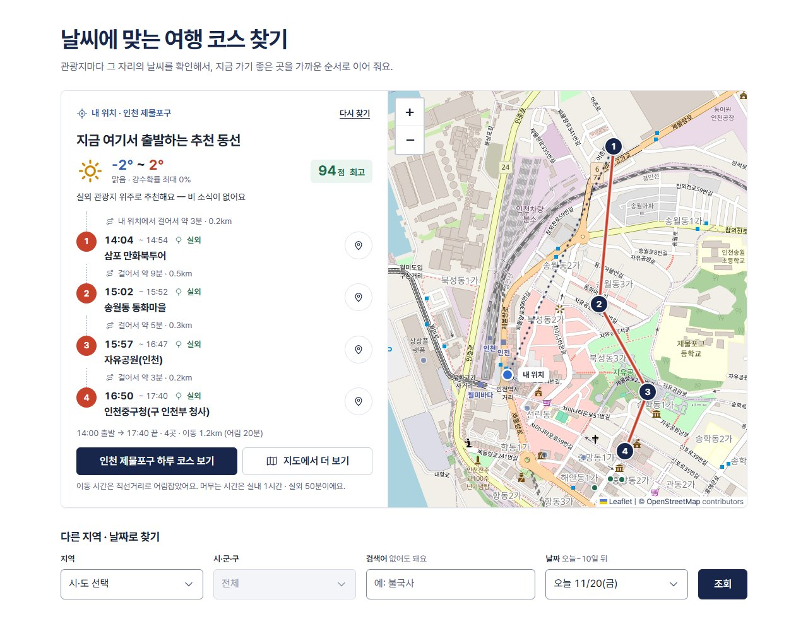
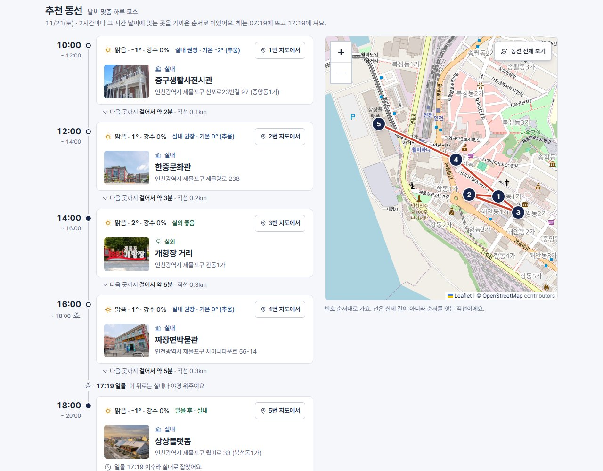
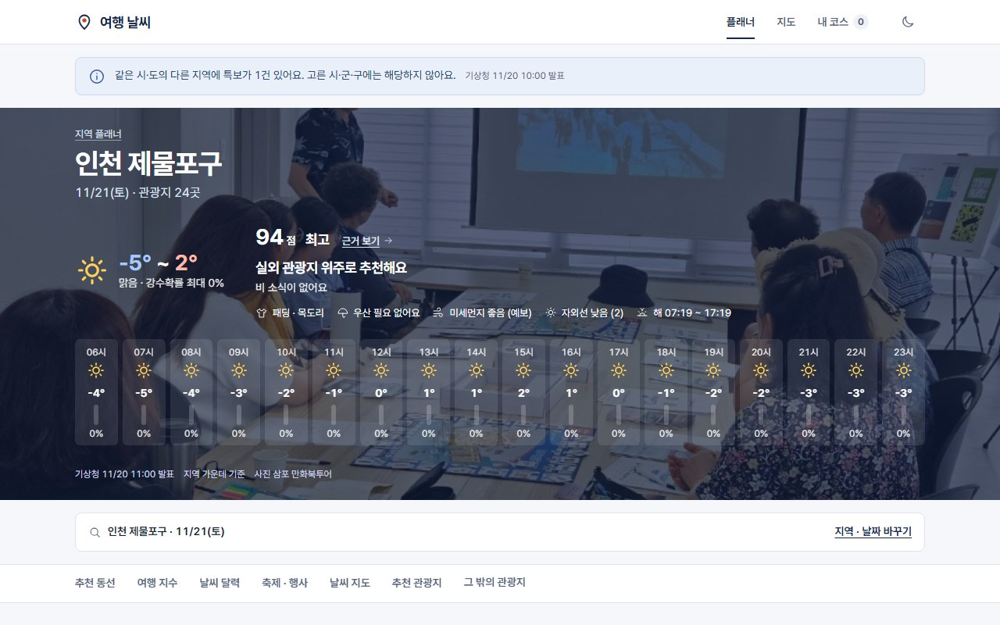
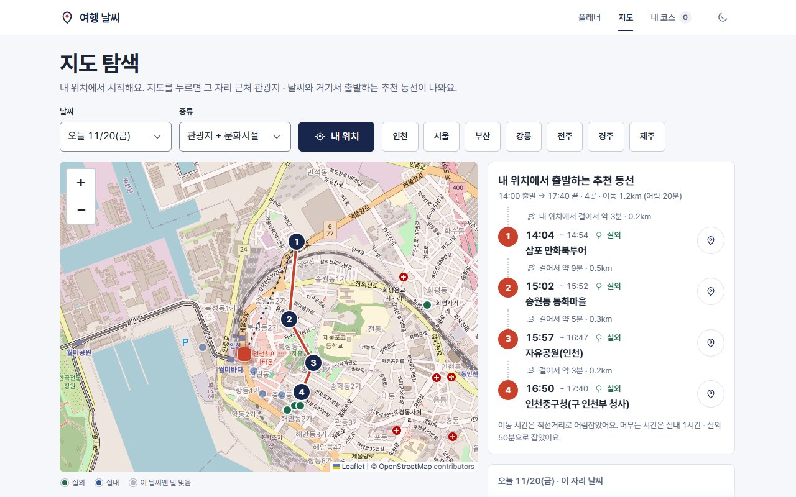
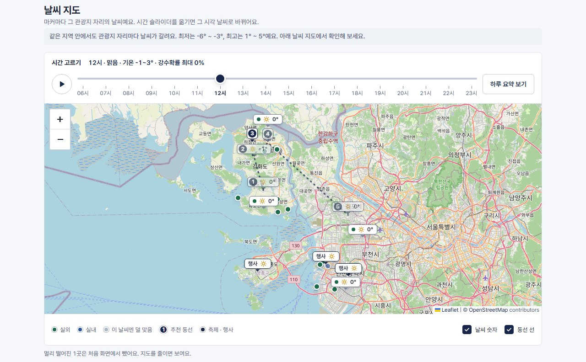
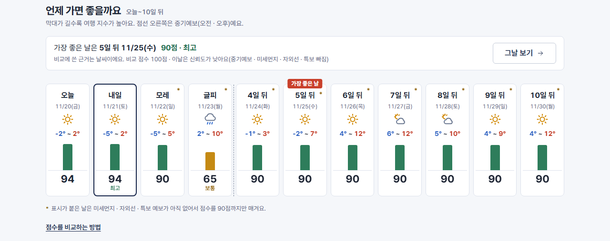
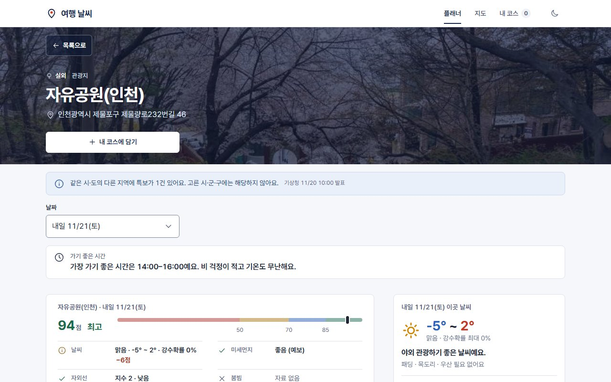
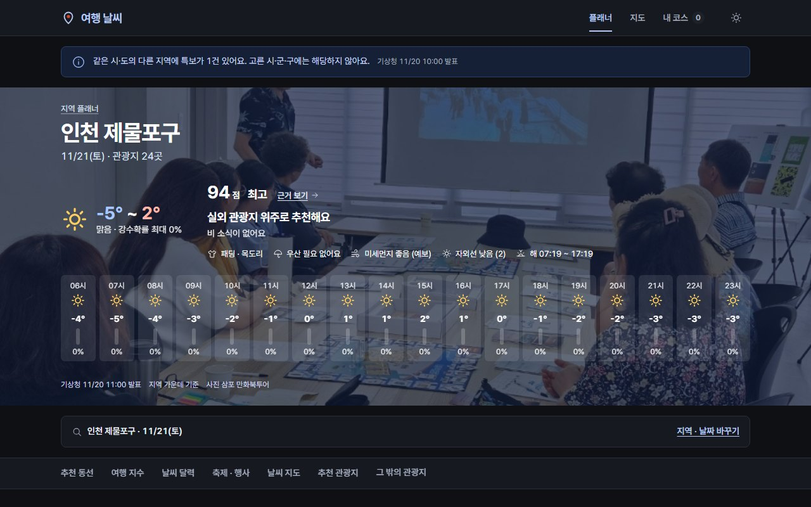
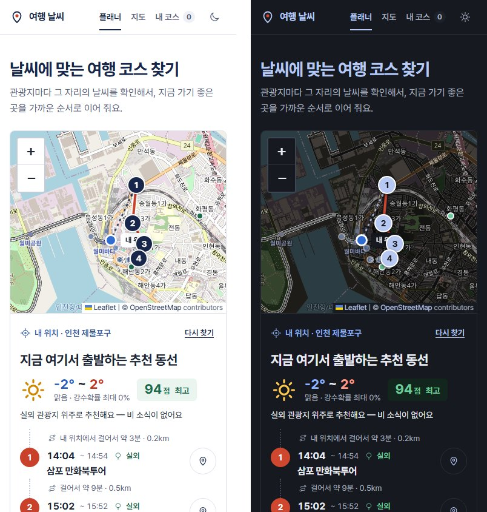

# 여행 날씨 (TourWeather)

관광지마다 **그 자리의 날씨**를 확인해서, 지금 가기 좋은 곳을 가까운 순서로 이어 주는(추천 동선) 웹 앱입니다.
처음 열면 내 위치에서 시작하고, 위치를 못 받으면 인천 개항장 일대를 보여 줍니다.
한국관광공사 TourAPI와 기상청 · 에어코리아 · 천문연 공공 API 여러 개를 엮었습니다. 학교 수업의 OpenAPI 융합 과제로 만들었습니다.

- JSP + Servlet (Model 2) · `java.net.http.HttpClient` · Gson
- Java 17 · Tomcat 11 (jakarta.*) · 프레임워크 없음

## 화면



<table>
  <tr>
    <td width="50%"><br><b>추천 동선</b> — 2시간 칸마다 그 자리 날씨에 맞는 곳을 가까운 순서로 잇고, 옆 지도에 번호와 선으로 그립니다. 구간마다 걸어서 · 차로 어림 시간을 붙입니다.</td>
    <td width="50%"><br><b>지역 플래너</b> — 그날 날씨 · 여행 지수 · 시간별 예보를 맨 위에 모읍니다.</td>
  </tr>
  <tr>
    <td><br><b>지도 탐색</b> — 내 위치에서 시작합니다. 지도를 누르면 그 자리 근처 관광지 · 날씨와 거기서 출발하는 동선이 나옵니다.</td>
    <td><br><b>날씨 지도</b> — 관광지마다 날씨 마커. 고른 지역으로 확대하고, 좌표가 멀리 튄 곳은 처음 화면에서 뺍니다.</td>
  </tr>
  <tr>
    <td><br><b>날씨 달력</b> — 오늘부터 10일 뒤까지 여행 지수를 비교하고 가장 좋은 날을 고릅니다.</td>
    <td><br><b>관광지 상세</b> — 사진 · 이용 안내 · 그날 날씨와 여행 지수.</td>
  </tr>
  <tr>
    <td><br><b>블랙 모드</b> — 머리 오른쪽 단추로 켜고 끕니다.</td>
    <td align="center"><br><b>휴대폰</b> — 좁은 화면에서는 지도를 위에, 동선 목록을 아래에 둡니다.</td>
  </tr>
</table>

화면은 2026-11-20 실제 API 응답으로 인천을 예시로 찍었습니다(날짜 · 날씨 · 점수는 그날 기준). 첫 화면 · 지도 탐색은 위치를 인천 개항장으로 두고 찍었습니다.

## 기능

| 화면 | 하는 일 |
|---|---|
| 첫 화면 「지금 내 주변」 | 내 위치(못 받으면 인천 개항장 일대)의 지금 날씨 · 여행 지수와, 거기서 출발해 근처 관광지 4곳을 도는 추천 동선을 지도와 함께 보여 줍니다. 그 자리의 시 · 군 · 구 하루 코스로 바로 넘어갑니다. |
| 지역 플래너 `/plan` | 시 · 도 / 시 · 군 · 구 / 날짜(오늘~10일 뒤)로 관광지를 불러와 관광지 격자마다 기상청 예보를 붙입니다. 실내 · 실외를 날씨에 맞춰 추천합니다. |
| 여행 지수 | 날씨 · 미세먼지 · 자외선 · 붐빔 · 기상특보를 100점으로 묶고, 근거를 줄 단위로 보여 줍니다. 자료가 빠진 날은 「불확실」로 표시하고 90점까지만 매깁니다. |
| 날씨 달력 | 0~3일은 단기예보, 4~10일은 중기예보를 이어 붙여 11일을 비교합니다. 「가장 좋은 날」은 모든 날에 공통으로 있는 근거만으로 고릅니다. |
| 추천 동선(하루 코스) | 2시간 칸마다 날씨에 맞는 곳을 가까운 순서로 잇고, 해가 지기 전에 실외 일정을 끝냅니다. 옆 지도에 번호와 선으로 그리고, 구간마다 걸어서 · 차로 어림 시간을 붙입니다(길 찾기 API 없이 직선거리로 어림). 비 위험이 있는 실외 칸에는 5km 안의 실내 대안(플랜 B)을 붙입니다. |
| 날씨 지도 | Leaflet 지도 위에 관광지별 날씨 마커를 그립니다. 시간 슬라이더를 옮기면 그 시각의 날씨로 바뀝니다. 분류 칩(자연 · 역사 · 체험 …)으로 거를 수 있습니다. 고른 지역으로 확대하고, 좌표가 멀리 튄 곳은 처음 화면에서 빼고 알려 줍니다. |
| 축제 · 행사 | 고른 날 열리고 있는 행사와 그 자리 날씨를 보여 주고, 야외 행사에 비 예보가 있으면 알립니다. |
| 상세 `/detail` | 사진 · 이용 안내 · 그날 날씨와 여행 지수 · 주변 관광지를 보여 줍니다. |
| 지도 탐색 `/explore` | 내 위치에서 시작합니다(못 받으면 인천 개항장 일대). 지도를 누르면 그 자리 근처 관광지 · 날씨와 거기서 출발하는 추천 동선을 보여 줍니다. |
| 내 코스 `/course` | 담은 곳을 순서대로 정리하고 예상 시간 · 날씨 · 거리를 보여 줍니다. 공유 링크(읽기 전용 · 가져오기), 캘린더(.ics, RFC 5545), 인쇄(A4)를 지원합니다. |

JS가 꺼져 있어도 링크와 폼만으로 동작합니다. 좁은 화면에서는 가로 띠가 넘칠 때만 옆으로 넘기게 했습니다.
블랙 모드는 머리 오른쪽 단추로 켜고 끕니다. 고른 적이 없으면 기기 설정(다크 모드)을 따릅니다.

## 쓰는 공공 API (공공데이터포털)

| API | 쓰는 곳 |
|---|---|
| 한국관광공사 국문 관광정보 서비스 (KorService2) | 지역 목록 · 키워드 검색 · 위치 기반 · 상세 · 행사(searchFestival2) · 분류(lclsSystmCode2) · 법정동 코드 |
| 한국관광공사 관광지 집중률 방문자 추이 예측 | 붐빔 |
| 기상청 단기예보 (VilageFcstInfoService 2.0) | 관광지 격자별 시간 예보 (0~3일) |
| 기상청 중기예보 (MidFcstInfoService) | 4~10일 오전 · 오후 날씨와 기온 |
| 기상청 생활기상지수 (LivingWthrIdxServiceV5) | 자외선 지수 |
| 기상청 기상특보 (WthrWrnInfoService) | 특보 띠 · 점수 상한 |
| 한국환경공단 에어코리아 대기오염정보 | 미세먼지 · 초미세먼지 |
| 한국천문연구원 출몰시각 정보 | 해 뜨는 · 지는 시각 |

호출을 아끼려고 응답을 메모리에 잠깐 캐시하고(목록 30분 · 상세 6시간 등), 서로 상관없는 호출은 동시에 보냅니다. 오류 응답은 캐시하지 않습니다.

## 구조 (Model 2)

```
src/main/java/com/inha/controller   서블릿 (PlanController · DetailController · CourseController · ExploreController · AroundController …)
src/main/java/com/inha/model        DAO · VO · 점수(TravelScore) · 코스 짜기(CoursePlanner) · 내 주변 동선(NearbyRoute) · 예보 잇기(ForecastStitcher) · 캘린더(IcsBuilder)
src/main/webapp/WEB-INF/views       JSP 화면
src/main/webapp/WEB-INF/jspf        공통 조각 (머리 · 카드 · 점수 · 플랜 B …)
src/main/webapp/css · js            스타일 · 보조 스크립트 (없어도 동작)
```

## 실행하기

1. JDK 17과 Tomcat 11을 준비합니다.
2. 이클립스에서 **File → Import → Existing Projects into Workspace** 로 이 폴더를 엽니다. 서버 런타임 이름은 `Apache Tomcat v11.0` 입니다.
3. [공공데이터포털](https://www.data.go.kr)에서 위 표의 API를 활용신청합니다. 개발계정은 자동승인이 많습니다.
4. 인증키를 넣습니다.
   `src/main/webapp/WEB-INF/apikey.example.txt` 를 복사해 같은 폴더에 `apikey.txt` 로 만듭니다. 그 파일의 첫 줄에 **일반 인증키(Decoding)** 를 한 줄로 넣습니다.
   `apikey.txt` 는 `.gitignore` 에 들어 있어서 저장소에 올라가지 않습니다.
5. Tomcat에 올리고 `http://localhost:8080/TourWeather/` 를 엽니다(포트는 설정에 따라 다름).

키 파일이 없으면 화면에 「인증키가 없어요」 안내가 나옵니다. 곁가지 API(미세먼지 · 자외선 · 붐빔 등)를 신청하지 않았거나 응답이 실패하면 그 근거만 「자료 없음」으로 표시하고, 나머지 화면은 그대로 동작합니다.

## 라이브러리

- [Gson 2.11.0](https://github.com/google/gson) (Apache 2.0)
- Jakarta Standard Tag Library 3.0 (EPL 2.0)
- 화면: [Leaflet 1.9.4](https://leafletjs.com) · [Pretendard](https://github.com/orioncactus/pretendard) (CDN)
- 지도 타일 © OpenStreetMap contributors
